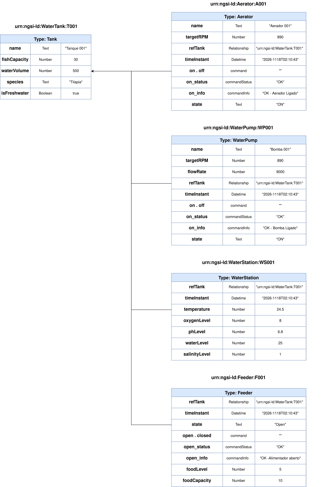

#+TITLE: PEL220 - Cultura de Peixes
#+SUBTITLE: Simulação de um sistema IoT integrado a um tanque de piscicultura. 
#+AUTHOR: Leon Ferreira Bellini, Vitor Acosta da Rosa, Luis Ricardo
#+LANGUAGE: pt-br
#+LATEX_HEADER: \usepackage[brazilian]{babel}
#+LATEX_HEADER: \usepackage[T1]{fontenc}
#+LATEX_HEADER: \usepackage{csquotes}
#+LATEX_HEADER: \usepackage[margin=2cm]{geometry}
#+CITE_EXPORT: biblatex backend=biber, style=abnt,sortlocale=pt_BR
#+BIBLIOGRAPHY: CulturaPeixes.bib

* Proposta

O presente trabalho propõe a simulação de uma estrutura IoT de um tanque de *piscicultura*, contando com o monitoramento em tempo real de variáveis como temperatura da água, salinidade, pH, nível da água, etc., o envio dessas variáveis para um centralizador, sendo esse, o *Orion Context Broker*. O sistema também permitirá o salvamento dessas variáveis em um banco de dados relacional para, então, consumo dessas linhas por meio de um painel do *Grafana* possibilitando a completa observabilidade do ambiente.

Por meio do acompanhamento dessas métricas, o sistema será capaz de se adaptar e, então, atuar automaticamente sobre o ambiente por meio de atuadores como uma *bomba de água*, para introduzir mais água fresca no tanque, drenando a água mais quente, além de controlar o nível de pH e um *aerador* para aprimorar o índice de oxigênio no ambiente.

O projeto, seu código e sua documentação contendo os diagramas de entidades e arquitetura geral, podem ser encontrados em [[https://github.com/seleonel/PEL220-CulturaDePeixes][PEL220-CulturaDePeixes]] \nocite{paginaGithub}.

* Introdução

A piscicultura tem se consolidado como uma importante atividade da aquicultura, contribuindo para a produção sustentável de alimentos e para o atendimento da crescente demanda mundial por pescado. Segundo Rastegari et al. (2023), a aquicultura é responsável por parcela significativa da produção de alimentos aquáticos e depende fortemente da manutenção de condições adequadas de qualidade da água para garantir produtividade, sustentabilidade e bem-estar animal.

Nesse contexto, a IoT tem sido apontada como uma das principais tecnologias habilitadoras da chamada /Smart Aquaculture/. De acordo com Costa et al. (2025), a utilização de sensores conectados, sistemas de monitoramento e plataformas digitais possibilita o acompanhamento contínuo de parâmetros ambientais e apoia a tomada de decisão em tempo real, permitindo a redução da intervenção humana e maior eficiência operacional. 
Entre os parâmetros mais relevantes para a piscicultura estão a temperatura da água, o pH, o oxigênio dissolvido, a salinidade e o nível da água. Rastegari et al. (2023) destacam que o monitoramento contínuo dessas variáveis é fundamental para reduzir perdas produtivas, prevenir situações de estresse e garantir condições adequadas para o desenvolvimento dos peixes. 

Como espécie de referência para este trabalho foi escolhida a Tilápia-do-Nilo (/Oreochromis niloticus/), amplamente utilizada na piscicultura devido à sua resistência a variações ambientais e facilidade de cultivo. Rastegari et al. (2023) apontam a tilápia como uma das espécies mais tolerantes a alterações das condições ambientais quando comparada a outras espécies de interesse comercial, tornando-a adequada para sistemas intensivos e para a aplicação de soluções baseadas em IoT.

Além de sua relevância econômica para a aquicultura, a Tilápia-do-Nilo ganhou destaque em pesquisas brasileiras voltadas à área da saúde. Conforme relatado por Lima Júnior (2017), sua pele vem sendo estudada como curativo biológico para o tratamento de queimaduras, apresentando características favoráveis como elevada aderência à lesão, disponibilidade e potencial para redução do número de trocas de curativos. 

* Justificativa

A realização de medições manuais e periódicas dos parâmetros físico-químicos da água pode dificultar a identificação rápida de situações que comprometam a saúde dos peixes. Segundo Costa et al. (2025), a adoção de sistemas baseados em IoT permite a coleta contínua de dados e a execução de mecanismos de monitoramento e atuação distribuídos, reduzindo a dependência de intervenções exclusivamente humanas. 

Dessa forma, propõe-se a simulação de uma infraestrutura IoT para um tanque de piscicultura, utilizando sensores, protocolos de comunicação e ferramentas de observabilidade para monitorar o ambiente em tempo real e realizar ações automáticas quando necessário. O projeto busca demonstrar, em um cenário acadêmico, a aplicação prática de conceitos de IoT, monitoramento distribuído, gerenciamento de contexto e automação aplicados à criação de Tilápia-do-Nilo.

* Membros

Na tabela [[GrupoMembros]] são listados os membros do grupo juntamente a seus registros acadêmicos.

#+NAME: GrupoMembros
| Nome                  |         RA |
|-----------------------+------------|
| Leon Ferreira Bellini | 00126315-1 |
| Vitor Acosta da Rosa  | 00126306-0 |
| Luis Ricardo          |            |
|-----------------------+------------|

* Arquitetura
:PROPERTIES:
:ID:       241361ed-b68c-42ea-bf7c-6c7f36b0cc79
:END:

Na figura [[fig:arquitetura]], podemos observar a arquitetura da simulação, sendo que cada membro iniciando com =c:= se trata de um *contêiner* Docker (ou Podman)

#+DOWNLOADED: screenshot @ 2026-11-21 17:07:03
#+NAME: arquitetura
[[file:Arquitetura/2026-11-21_17-07-03_screenshot.png]]

** Protocolos
| Componente                | Tecnologia           |
|---------------------------|----------------------|
| Microcontrolador          | ESP32                |
| Broker MQTT               | Mosquitto            |
| Conversão MQTT <-> NGSI   | IoT Agent JSON       |
| Gerenciamento de Contexto | Orion Context Broker |
| Banco Operacional         | MongoDB              |
| Persistência Histórica    | Cygnus               |
| Banco Histórico           | MySQL                |
| Dashboard                 | Grafana              |

** Sensores e Atuadores
| Sensor                              | Função                                                  | Unidade    |
|-------------------------------------|---------------------------------------------------------|------------|
| Sensor de Temperatura da Água       | Monitorar a temperatura do tanque                       | °C         |
| Sensor de pH                        | Monitorar a acidez/alcalinidade da água                 | pH         |
| Sensor de Salinidade                | Monitorar a concentração de sais dissolvidos            | ppt ou g/L |
| Sensor de Oxigênio Dissolvido       | Monitorar o nível de oxigênio disponível para os peixes | mg/L       |
| Sensor de Nível da Água             | Monitorar o volume disponível no tanque                 | cm         |

| Atuador                | Função                                  |
|------------------------|-----------------------------------------|
| Alimentador Automático | Liberar ração para os peixes            |
| Bomba de Água          | Realizar circulação e renovação da água |
| Aerador                | Oxigenar a água quando necessário       |

* Entidades
:PROPERTIES:
:ID:       cee24c34-7e39-4163-9b1f-151d478071a2
:END:

Na imagem [[fig:entidades]], podemos observar o modelo básico de entidades as quais serão cadastradas na base do *Orion Context Broker*, contendo os seguintes membros, com suas descrições:

|--------------+------------------------------------------------------|
| Entidade     | Descrição                                            |
|--------------+------------------------------------------------------|
| WaterTank    | Representação do tanque de piscicultura.             |
| WaterStation | Grupo de sensores para coleta de dados do tanque     |
| Aerator      | Aerador que introduzirá oxigênio à água.             |
| WaterPump    | Bomba de água que introduzirá água limpa ao ambiente |
| Feeder       | Alimentador automático                               |
|--------------+------------------------------------------------------|

#+DOWNLOADED: screenshot @ 2026-11-21 17:10:54
#+NAME: entidades
[[file:Entidades/2026-11-22_19-44-22_screenshot.png]]

O projeto foi desenhado com a intenção de permitir a escalabilidade e adição de novos membros. Um novo tanque pode ser adicionado com todos os grupos de atuadores e sensores ao /Orion Context Broker/ com um novo ID seguindo o padrão definido, esse sendo:

: [A-z][A-z]?[0-9]{1,3}

Um *exemplo* de uma base do Orion preenchida com *um* tanque pode ser encontrado na figura [[fig:entidadesPreenchidas]], abaixo.

#+NAME: entidadesPreenchidas

* Dependências

1. =docker= ou =podman= instalado no sistema;
   - =docker-compose= ou =podman-compose= instalado no sistema;
2. Acesso a um sistema capaz de executar contêineres docker com suporte à virtualização;
3. Acesso a um sistema capaz de se conectar à Internet.

* Referências
COSTA, D.; ROCHA, E. M.; COSTA, V.; ROCHA, M. M.; MARQUES, C. Edge-enabled distributed digital twins with embedded intelligence for smart aquaculture systems. /Journal of Ambient Intelligence and Smart Environments/, v. 18, n. 1, p. 160-175, 2025.

LIMA JÚNIOR, E. M. Tecnologias inovadoras: uso da pele da tilápia do Nilo no tratamento de queimaduras e feridas. /Revista Brasileira de Queimaduras/, v. 16, n. 1, 2017.

RASTEGARI, H.; NADI, F.; LAM, S. S.; IKHWANUDDIN, M.; KASAN, N. A.; RAHMAT, R. F.; MAHARI, W. A. W. Internet of Things in aquaculture: a review of the challenges and potential solutions based on current and future trends. /Smart Agricultural Technology/, v. 4, p. 100187, 2023.

#+PRINT_BIBLIOGRAPHY: 

