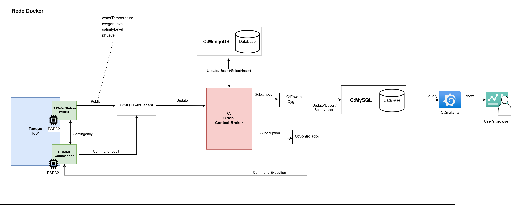
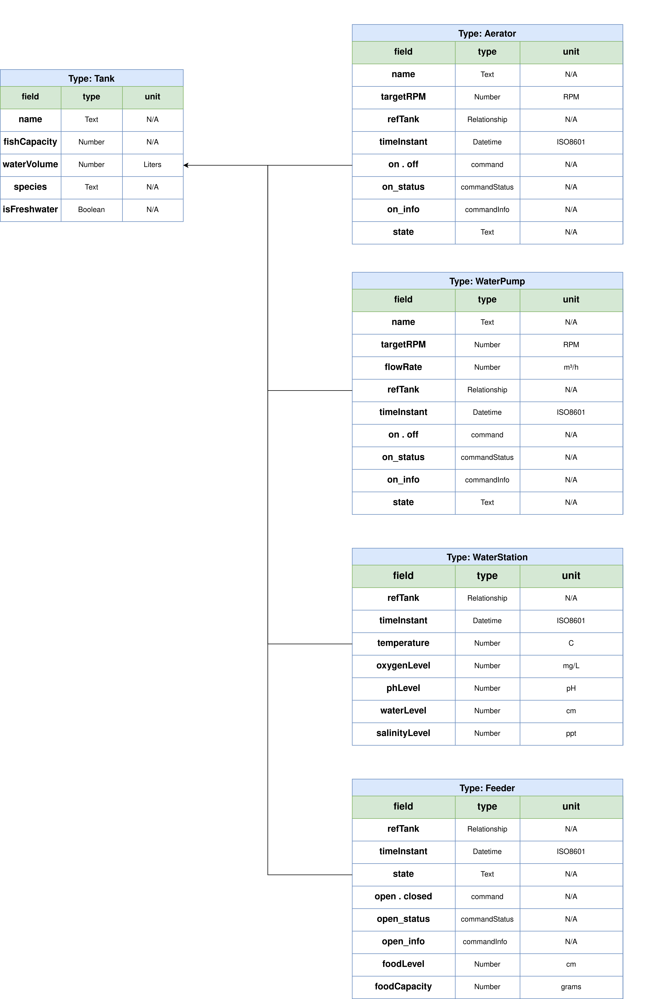

#+TITLE: PEL220 - Cultura de Peixes
#+SUBTITLE: Simulação de um sistema IoT integrado a um tanque de piscicultura. 
#+AUTHOR: Leon Ferreira Bellini, Victor Acosta, Luis Ricardo
#+LANGUAGE: pt-br
#+LATEX_HEADER: \usepackage[brazilian]{babel}
#+LATEX_HEADER: \usepackage[T1]{fontenc}
#+LATEX_HEADER: \usepackage{csquotes}
#+LATEX_HEADER: \usepackage[margin=2cm]{geometry}
#+CITE_EXPORT: biblatex backend=biber, style=abnt,sortlocale=pt_BR
#+BIBLIOGRAPHY: CulturaPeixes.bib

* Proposta

O presente trabalho propõe a simulação de uma estrutura IoT de um tanque de *piscicultura*, contando com o monitoramento em tempo real de variáveis como temperatura da água, salinidade, pH, nível da água, etc., o envio dessas variáveis para um centralizador, sendo esse, o *Orion Context Broker*. O sistema também permitirá o salvamento dessas variáveis em um banco de dados relacional para, então, consumo dessas linhas por meio de um painel do *Grafana* possibilitando a completa observabilidade do ambiente.

Por meio do acompanhamento dessas métricas, o sistema será capaz de se adaptar e, então, atuar automaticamente sobre o ambiente por meio de atuadores como uma *bomba de água*, para introduzir mais água fresca no tanque, drenando a água mais quente, além de controlar o nível de pH e um *aerador* para aprimorar o índice de oxigênio no ambiente.

O projeto, seu código e sua documentação contendo os diagramas de entidades e arquitetura geral, podem ser encontrados em [[https://github.com/seleonel/PEL220-CulturaDePeixes][PEL220-CulturaDePeixes]] \nocite{paginaGithub}.

* Membros

Na tabela [[GrupoMembros]] são listados os membros do grupo juntamente a seus registros acadêmicos.

#+NAME: GrupoMembros
| Nome                  |         RA |
|-----------------------+------------|
| Leon Ferreira Bellini | 00126315-1 |
| Victor Acosta         |            |
| Luis Ricardo          |            |
|-----------------------+------------|

* Arquitetura
:PROPERTIES:
:ID:       241361ed-b68c-42ea-bf7c-6c7f36b0cc79
:END:

Na figura [[fig:arquitetura]], podemos observar a arquitetura da simulação, sendo que cada membro iniciando com =c:= se trata de um *contêiner* Docker (ou Podman)

#+DOWNLOADED: screenshot @ 2026-11-21 17:07:03
#+NAME: arquitetura

** Protocolos
** Sensores

* Entidades
:PROPERTIES:
:ID:       cee24c34-7e39-4163-9b1f-151d478071a2
:END:

Na imagem [[fig:entidades]], podemos observar o modelo básico de entidades as quais serão cadastradas na base do *Orion Context Broker*, contendo os seguintes membros, com suas descrições:

|--------------+------------------------------------------------------|
| Entidade     | Descrição                                            |
|--------------+------------------------------------------------------|
| WaterTank    | Representação do tanque de piscicultura.             |
| WaterStation | Grupo de sensores para coleta de dados do tanque     |
| Aerator      | Aerador que introduzirá oxigênio à água.             |
| WaterPump    | Bomba de água que introduzirá água limpa ao ambiente |
| Feeder       | Alimentador automático        |
|--------------+------------------------------------------------------|

#+DOWNLOADED: screenshot @ 2026-11-21 17:10:54
#+NAME: entidades

O projeto foi desenhado com a intenção de permitir a escalabilidade e adição de novos membros. Um novo tanque pode ser adicionado com todos os grupos de atuadores e sensores ao /Orion Context Broker/ com um novo ID seguindo o padrão definido, esse sendo:

: [A-z][A-z]?[0-9]{1,3}

Um *exemplo* de uma base do Orion preenchida com *um* tanque pode ser encontrado na figura [[fig:entidadesPreenchidas]], abaixo.

#+NAME: entidadesPreenchidas
[[file:Entidades/2026-11-21_17-10-54_screenshot.png]]

* Dependências

1. =docker= ou =podman= instalado no sistema;
   - =docker-compose= ou =podman-compose= instalado no sistema;
2. Acesso a um sistema capaz de executar contêineres docker com suporte à virtualização;
3. Acesso a um sistema capaz de se conectar à Internet.

#+PRINT_BIBLIOGRAPHY: 

